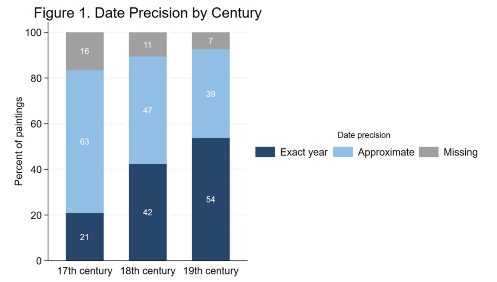
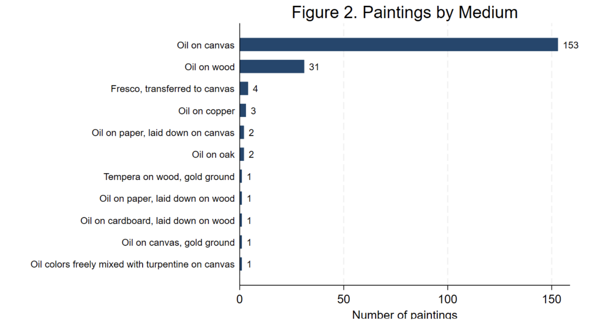

# Data

This folder contains the data used in Predicting the Century of European Paintings (Pink Panthers — DS 4002, Project #4).

### Initial Data

The initial data were collected from The Metropolitan Museum of Art Collection API (https://collectionapi.metmuseum.org/public/collection/v1) by `SCRIPTS/metpulldata.ipynb`. Only public-domain works were collected; The Met releases these images under its Open Access (CC0) policy.

| File | Description |
|---|---|
| `metadata_balanced.csv` | One row per painting for 200 European paintings sampled from The Met's European Paintings department: 67 from the 17th century, 66 from the 18th, and 67 from the 19th. Columns: `object_id` (The Met's object ID), `filename` (relative image path), `title`, `artist`, `date` (as written by The Met), `century` (17, 18, or 19, assigned only when the work's begin and end dates fall in the same century), `medium`, `classification`, `image_url`, and `artwork_url`. |

Rerunning `SCRIPTS/metpulldata.ipynb` may not produce exactly the same 200 paintings, because The Met updates its collection over time. The files in this folder are the exact sample used in this project.

### Final Analysis Data

The final data analyzed are generated from the initial files above by `SCRIPTS/ds_project_3.ipynb`. A copy is stored in this folder and is identical to the file the notebook writes to `OUTPUT/`:

| File | Description |
|---|---|
| `DATA/resnet18_features.csv` | The 200 paintings as analyzed (518 columns). Each image was resized to 224×224, normalized with ImageNet statistics, and passed through a pretrained ResNet-18 with its final classification layer removed, producing 512 features per painting (`feature_0` to `feature_511`). Also includes `object_id`, `filename`, `artist`, `century`, `painting_level_split` (`train`/`test` in the 80/20 split stratified by century; 160/40), and `artist_grouped_split` (`train`/`test` in the split that keeps each artist entirely in one set; 157/43). |

## Data Summary

The dataset contains about 200 public-domain European paintings from The Metropolitan Museum of Art. They are split roughly evenly across the 17th, 18th, and 19th centuries, with about 66 paintings each. The first part is a folder of painting images and the second is a CSV file with one row per painting. These files will be uploaded using the script. We built the dataset with a Python script that utilizes The Met Collection API. The script searches the Met’s European Paintings department for works that have images and requests each work’s record. It keeps only paintings marked as public domain and dated between 1600 and 1899, downloads each painting’s main image, and writes the information to the CSV which will be uploaded to our GitHub for anyone to access.

## Provenance
The dataset was constructed using the Met’s open access database. It is a collection of images and data about art pieces in The Met collection. Since 2017, the Met’s Open Access program has made images of its public-domain artworks and basic data on its collection freely available. The museum shares this material through its public Collection API. The century labels come from the museum’s dates, and many of those are estimates (for example, “ca. 1650”), so the labels are approximate.

## License

For our project, we identify the Met as the data source. We use the Met’s open access initiative which made their images of public-domain artworks and basic data on all accessioned works in its collection available for unrestricted use under Creative Commons Zero (CC0). This allows us to download and share the images and data of the Met’s artworks. 

## Ethical Statement
This project only uses images and data from the MET that was released into the public domain through its Open Access program. This ensures that no copyrighted material or personal data is involved. We will follow the Met’s API terms of use by crediting the museum as the data source. Our model’s conclusions apply only to this narrow collection of artwork. The dating comes from museum records and some data are rough estimates. Therefore, we will treat these labels as approximate. The model is not meant to authenticate artworks in practice where errors could have financial or academic consequences. 

## Data Dictionary

#### `metadata_balanced.csv` (200 rows, 10 columns)

| Column | Type | Description | Values / Example |
|---|---|---|---|
| `object_id` | Integer | The Met's unique identifier for the artwork | e.g. `436145` |
| `filename` | String | Relative path to the painting's image within this folder | e.g. `images/436145.jpg` |
| `title` | String | Title of the artwork as listed by The Met | Free text |
| `artist` | String | Artist's display name as listed by The Met; may be blank for unattributed works | e.g. `Rembrandt` |
| `date` | String | Date of the work as written by The Met, which may be approximate or a range | e.g. `ca. 1665`, `1780–85` |
| `century` | Integer | Century the painting was made in, derived from The Met's `objectBeginDate` and `objectEndDate`. A painting was only included if both dates fall in the same century. **This is the target variable.** | `17` (1601–1700), `18` (1701–1800), `19` (1801–1900) |
| `medium` | String | Materials used | e.g. `Oil on canvas` |
| `classification` | String | The Met's object classification | `Paintings` (all rows) |
| `image_url` | String (URL) | Source URL of the downloaded image (The Met's `primaryImageSmall`) | `https://images.metmuseum.org/...` |
| `artwork_url` | String (URL) | Link to the artwork's page on metmuseum.org | `https://www.metmuseum.org/art/collection/search/...` |

#### `resnet18_features.csv` (200 rows, 518 columns)

| Column | Type | Description | Values / Example |
|---|---|---|---|
| `object_id` | Integer | The Met's unique identifier; links each row to `metadata_balanced.csv` | e.g. `436145` |
| `filename` | String | Relative path to the image the features were extracted from | e.g. `images/436145.jpg` |
| `artist` | String | Artist's display name; used to build the artist-grouped split | e.g. `Rembrandt` |
| `century` | Integer | Century the painting was made in. **Target variable.** | `17`, `18`, `19` |
| `painting_level_split` | Categorical | The painting's set in the 80/20 train/test split stratified by century | `train` (160), `test` (40) |
| `artist_grouped_split` | Categorical | The painting's set in the train/test split that keeps all of an artist's paintings in the same set | `train` (157), `test` (43) |
| `feature_0` … `feature_511` | Float | 512 image features from a pretrained ResNet-18 (ImageNet weights) with the final classification layer removed. Each is the output of the network's final pooling layer. They're not individually interpretable but together summarize the image's visual content. **These are the model's input variables.** | Non-negative decimals, e.g. `0.8431` |

## Explanatory Plots

### Figure 1. Date Precision by Century 

This chart shows how precisely the Met dates the paintings in each century. Precision drops with age. 54% of 19th-century paintings have an exact year, compared with 42% of 18th-century and only 21% of 17th-century paintings. Most 17th-century dates are approximate, such as “ca. 1650” or “1640s” (63%), and 16% are missing. Our century labels are therefore least certain for the oldest paintings, and we treat them as approximate throughout the analysis. 

### Figure 2. Paintings by Medium

This chart shows the materials used for the paintings in our dataset. Nearly all are oil on canvas (153 of 200) or oil on wood (31 of 200). The other 16 are spread across nine less common mediums, such as fresco, copper, and paper, with 1 to 4 paintings each. Because the dataset is so uniform in medium, the model will mostly have to tell centuries apart by visual style rather than by the material.
